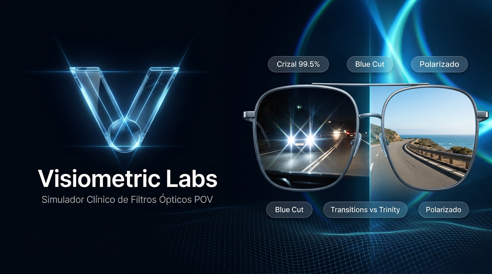

# 👓 Filtros Ópticos — Simulador y Comparador Clínico Interactivo
> **Suite Visiometric Labs — JayzirTech**  
> *Plataforma en Primera Persona (POV) de Demostración Oftálmica y Argumentación en Mostrador*

🌐 **[English (README.md)](./README.md)** • **[Español]**

[](https://visiometric-labs.github.io/filters-simulator/)
[](https://vitejs.dev/)
[-F7DF1E?logo=javascript&logoColor=black)](https://developer.mozilla.org/en-US/docs/Web/JavaScript)
[]()



---

## 🌐 Demo Pública en Vivo
Accede al simulador interactivo desplegado en producción:  
👉 **[https://visiometric-labs.github.io/filters-simulator/](https://visiometric-labs.github.io/filters-simulator/)**

---

## 📌 ¿Qué es este Simulador?
Una herramienta digital de consultorio y mostrador óptico diseñada para resolver la mayor objeción comercial en la venta de lentes: **el paciente no compra lo que no puede experimentar**.

Permite que el paciente experimente **en primera persona (POV)**, dentro de una montura oftálmica panorámica de alta definición, el efecto óptico real de los diferentes tratamientos comerciales del mercado:
- **Lente Normal (Sin tratamiento / Control):** Demuestra los reflejos parásitos de superficie, deslumbramiento descontrolado en noche y fatiga fotópica por luz LED fría en pantallas.
- **Antirreflejo Verde (Estándar de mercado):** Supresión de halos nocturnos y neutralización de reflejos de lámparas y ventanas.
- **Crizal Multicapa (Gama Premium 5 en 1):** Claridad quirúrgica con 99.5% de transmisión, negros profundos sin velo lumínico y corte nítido de faros.
- **Filtro Amarillo (DriveSafe Nocturno & Lluvia):** Realce dramático del contraste del pavimento y absorción de luz azul molesta de faros xenón/LED.
- **Filtro Blue Cut (Protección Pantallas LED):** Transformación del blanco LED frío y agresivo (~8500K) a un confort cálido descansado tipo papel (~4500K) sin perder nitidez tipográfica en hojas de cálculo y documentos.
- **Fotocromáticos en Tiempo Real (Trinity vs. Transitions):** Demostración cinética automática entre la gama estándar (*Trinity*, Cat. 2, 65%) y la gama alta (*Transitions Signature*, Cat. 3, 88%) con inicio transparente (0%) y reactivación solar interactiva.
- **Filtro Polarizado:** Cancelación total del resplandor enceguecedor horizontal en asfalto mojado y agua.
- **Crizal Multicapa (Gama Premium 5 en 1):** Claridad quirúrgica con 99.5% de transmisión, negros profundos sin velo lumínico y corte nítido de faros. Ubicado a la derecha de cada escenario para facilitar la comparativa de máxima gama.

---

## 🚗 Escenarios Clínicos Calibrados (Fotografía Multicapa 2K Master HD)

### 1. 🚗 Conducción Nocturna (Avenida en Mercedes-Benz Clase S)
- **Perspectiva:** Cabina de lujo en primera persona con cuadro de instrumentos digital activo, volante multifunción, iluminación ambiental LED y tráfico real.
- **Placas Ópticas 2K Calibradas:** `night-blanco`, `night-ar-verde`, `night-crizal` y `night-amarillo`.
- **Filtro Amarillo DriveSafe Refinado:** Calibración sutil del tinte ámbar (sin saturación chillona) sobre base de alta nitidez Crizal, eliminando el deslumbramiento de faros LED y resaltando el pavimento y las marcas viales con alto contraste.

### 2. 💻 Oficina y Pantallas (Entorno Corporativo Ultrawide Dell)
- **Perspectiva:** Escritorio ergonómico de madera con teclado mecánico y monitor ultrawide curvo Dell con hojas de cálculo financieras ("Q3 Sales Performance") y documentos de texto.
- **Filtro Blue Cut de Confort Marfil:** Modulación cálida natural (~5000K) que alivia la fatiga visual por sobreexposición LED fría (~8500K), manteniendo el texto de hojas de cálculo y gráficos 100% nítidos sin distorsiones cromáticas excesivas.
- **Crizal Multicapa:** Claridad neutra pura (99.5% transmisión) para contraste tipográfico de alta fidelidad sin reflejos parásitos de lámpara.

### 3. ☀️ Día Soleado y Exteriores (Carretera Panorámica Costera 2K)
- **Perspectiva:** Carretera abierta frente al mar bajo radiación solar intensa con destellos orgánicos multicapa sobre asfalto y oleaje.
- **Cinética Fotocromática en Tiempo Real (Trinity vs Transitions):**
  - Al seleccionar cualquier lente fotocromática, inicia **100% transparente** (Cat. 0).
  - **Transitions Signature:** Reacciona a gran velocidad alcanzando **Cat. 3 (88% de absorción solar)** en tono gris grafito profundo en ~3.6s.
  - **Fotocromático Trinity:** Oscurecimiento estándar de masa, estabilizándose en **Cat. 2 (65% de absorción solar)** en tono gris neutro.
  - **Controlador Interactivo:** Indicador en tiempo real de porcentaje de absorción solar, categoría óptica, barra de progreso y botón de **"Reactivar Sol"** para repetir la prueba ante el paciente.
- **Filtro Polarizado:** Cancelación de más del 95% del resplandor especular horizontal, realce del contraste de las marcas viales y saturación profunda de aguas turquesas.
- **Crizal Multicapa:** Transmisión del 99.5% y protección contra radiación UV posterior reflejada.

---

## 🎨 Experiencia de Usuario y Diseño Cyber-Clínico

- **Portada de Bienvenida (Welcome Landing):** Acceso introductorio al simulador con selector directo de escenarios y botón de inicio.
- **Transición Cinemática Diagonal (700ms):** Cierre orgánico de persianas oscuras desde las esquinas exteriores hacia el centro y apertura desde el centro hacia afuera, revelando los filtros sin líneas brillantes ni destellos artificiales.
- **Tema Unificado Dark Glass (Glassmorphism):** Barra superior (*headbar*) y selector de filtros armonizados con el tema de la portada (`#070B14`, cristales translúcidos `rgba(11, 17, 32, 0.88)` con `backdrop-filter: blur(16px)` y acentos luminiscentes de alto contraste: verde esmeralda para AR Verde, azul rey `#2563EB` para Crizal, morado vibrante `#8B5CF6` para Polarizado y ámbar para Conducción/Transitions).
- **Controles Táctiles y Joystick Virtual:** Pomo ergonómico para girar la cabeza 360°, botón de conmutación rápida *"Ver con Gafas / Ver sin Gafas"* y tarjeta flotante explicativa de beneficios del paciente con barras métricas visualmente diferenciadas por tratamiento.
- **Estandarización de Controles:** Posicionamiento consistente de **Crizal Multicapa en el extremo derecho** de la barra de controles en todos los escenarios para facilitar la comparativa directa contra la gama más alta.
- **Optimización de Pantalla Completa para Tablets:** Configuración `viewport-fit=cover`, meta `theme-color: #070B14` y llamada nativa con `{ navigationUI: 'hide' }` para eliminar franjas blancas en iPad y tablets Android.

---

## 🔮 Hoja de Ruta y Próximos Desarrollos (Roadmap de Trabajo)

Para las siguientes fases de desarrollo y evolución del demostrador se ha planificado:

### 1. 🕶️ Módulo Especial Dedicado a Transitions (Doble Vista POV + Espejo 3ra Persona)
* **Doble Perspectiva (POV + Tercera Persona / Espejo):**
  * **Visión en 1ra Persona (POV):** Cómo ve el paciente a través de la lente mientras se oscurece con la radiación solar.
  * **Visión en 3ra Persona (Rostro del Paciente):** Demostración de cómo se ve la persona con las gafas puestas. Resuelve la objeción estética principal del comprador: apreciar cómo la lente transparente pasa de forma elegante a una gafa de sol oscura sin verse extraña.
* **Catálogo de Estilos:** Exploración de la línea clásica (Gris, Café, Verde Grafito) y de la gama de moda *Style Mirrors* (Plata, Azul, Bronce) sobre el rostro.
* **Exclusividad Transitions:** Trinity permanece en la escena general de sol para la comparativa de velocidad de entrada.

---

## 🛠️ Arquitectura y Tecnologías
- **Motor Gráfico:** Canvas 2D + SVG binocular HUD con doble pase de renderizado (visión periférica fuera de gafas vs. visión a través de las lentes).
- **Cinemática:** Giro de cabeza continuo a 60-144 FPS con interpolación subpíxel suave, controlado por arrastre de pantalla y joystick virtual.
- **HUD Panorámico:** Marco de titanio vectorial ultra-nítido con biseles reflectivos sin desenfoque artificial.
- **Resolución Universal de Recursos:** Helper `asset-helper.js` compatible con Vite local, compilación de producción y despliegue estático en GitHub Pages (`/filters-simulator/`).
- **Arquitectura de Eventos:** Bus de eventos desacoplado (`event-bus.js`) para sincronizar selector de lentes, tarjeta de beneficios, slider UV y cámara.
- **Pre-calentamiento de Caché Óptica:** Precarga paralela de placas maestras 2K (`night-blanco`, `night-crizal`, `night-ar-verde`, `sun-real`, `office-blue-cut`) para conmutaciones instantáneas sin pantalla blanca ni parpadeos.

---

## 🚀 Despliegue y Ejecución Local

### Requisitos
- Node.js 18+

### En Desarrollo
```bash
npm install
npm run dev
# Accede a http://localhost:5173/ (o el puerto indicado)
```

### Compilación para Producción
```bash
npm run build
# Genera los archivos optimizados en dist/
```

---

## 📂 Especificación Completa
Para una revisión exhaustiva de la taxonomía clínica de los filtros, argumentos de venta para el mostrador, física óptica y estructura detallada de código, consulta:
👉 [**`ESPECIFICACIONES_FILTROS.md`**](./ESPECIFICACIONES_FILTROS.md) • [**`SPECIFICATIONS.md` (English)**](./SPECIFICATIONS.md)

---

© 2026 Visiometric Labs — JayzirTech. Todos los derechos reservados.
