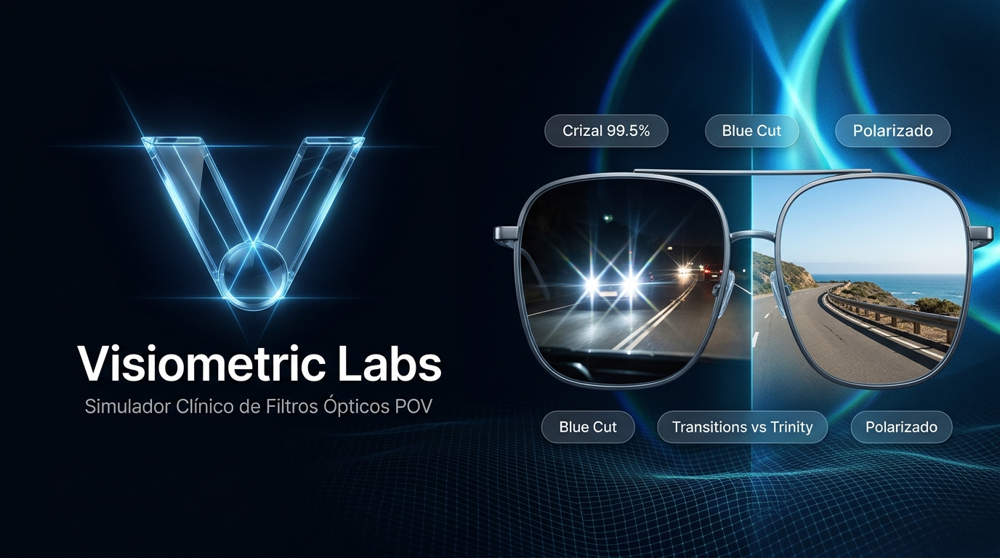

# 👓 Chromatis — Interactive Optical Filters POV Simulator
> **by Visiometric Labs • JayzirTech**  
> *First-Person (POV) Ophthalmic Demonstration Platform & Counter-Top Pitching Tool*

🌐 **[English]** • **[Español](./README.es.md)**

[](https://visiometric-labs.github.io/filters-simulator/)
[](https://vitejs.dev/)
[-F7DF1E?logo=javascript&logoColor=black)](https://developer.mozilla.org/en-US/docs/Web/JavaScript)
[]()



---

## 🌐 Live Public Demo
Access the interactive simulator deployed live in production:  
👉 **[https://visiometric-labs.github.io/filters-simulator/](https://visiometric-labs.github.io/filters-simulator/)**

---

## 📌 What is this Simulator?
A digital optometric consultation and counter-top sales tool engineered to solve the primary commercial barrier in eyeglass sales: **patients don't buy what they cannot experience**.

It empowers patients to experience **in the first person (POV)**, through a high-definition panoramic ophthalmic eyewear HUD, the real optical benefits of market-leading lens treatments:
- **Normal Lens (Untreated / Baseline Control):** Demonstrates surface parasitic reflections, blinding nighttime glare, and visual fatigue caused by harsh cold LED screen illumination.
- **Green Anti-Reflective (Standard Market AR):** Nighttime halo reduction and surface glare suppression on lamps and windows.
- **Crizal Multicoat (Premium 5-in-1 Suite):** Surgical clarity with 99.5% transmission, deep velvety blacks without luminescent veils, and razor-sharp cut of oncoming LED headlights. Positioned consistently at the far right of every scene for intuitive benchmark comparison.
- **Yellow Filter (DriveSafe Night & Rain):** High-contrast pavement definition and absorption of scattered short-wavelength blue light from modern xenon/LED headlamps.
- **Blue Cut Filter (Digital Screen Protection):** Softens aggressive cold white LED light (~8500K) into restful, warm ivory (~5000K) without sacrificing typographic edge clarity in spreadsheets and text documents.
- **Real-Time Photochromic Kinetics (Trinity vs. Transitions):** Automatic, live darkening kinetics comparing standard mass monomer photochromics (*Trinity*, Cat. 2, 65% ceiling) against high-speed molecular technology (*Transitions Signature*, Cat. 3, 88% sunglasses depth).
- **Polarized Filter (Horizontal Glare Cut):** 95%+ Brewster angle cancellation of horizontal polarized glare on wet asphalt and water surfaces, revealing rich turquoise depth and vibrant landscape saturation.

---

## 🚗 Calibrated Clinical Scenarios (2K Master HD Multilayer Photography)

### 1. 🚗 Night Driving (Mercedes-Benz S-Class Cabin)
- **Perspective:** First-person ultra-luxury vehicle cabin featuring digital instrument cluster, ambient LED cabin contours, and authentic night traffic with oncoming glare.
- **Calibrated 2K Master Plates:** `night-blanco`, `night-ar-verde`, `night-crizal`, and `night-amarillo`.
- **Refined DriveSafe Amber Tint:** Multilayer blend calibrated over a Crizal high-definition base (45% intensity), removing harsh yellow cast while maximizing asphalt lane marking contrast and rain safety.

### 2. 💻 Digital Office & Screens (Dell Ultrawide Workspace)
- **Perspective:** Modern executive wooden desk with mechanical keyboard and a curved Dell Ultrawide monitor displaying real financial spreadsheets ("Q3 Sales Performance") and text documents.
- **Ivory Rest Blue Cut Tint:** Calibrated warm white (~5000K) anti-fatigue modulation that eliminates cold HEV blue light fatigue while preserving 100% crisp typography and spreadsheet grid contrast.
- **Crizal Multicoat:** 99.5% luminous transmission for pure, glare-free typographic clarity without distracting interior ceiling light reflections.

### 3. ☀️ Sunny Outdoor & Coastal Highway (2K Panoramic Coastal Road)
- **Perspective:** Open coastal highway under intense solar radiation with organic multi-bounce water glitter and road shimmer.
- **Real-Time Photochromic Kinetics (Trinity vs. Transitions):**
  - Starts **100% transparent (Cat. 0)** upon selection, simulating indoor transition to bright outdoor sunlight.
  - **Transitions Signature:** Rapid sigmoidal response reaching ~70% in 1.5s and locking at **Category 3 (88% deep sunglasses absorption)** in graphite gray.
  - **Trinity Photochromic:** Standard mass technology stabilizing at **Category 2 (65% absorption)** in balanced neutral gray.
  - **Interactive HUD Controller:** Live readout of solar absorption percentage (%), optical category badge (`Cat. 0` to `Cat. 3`), animated progress bar, and a **Reactivar Sol (Retrigger Solar Activation)** button to replay the test on demand.
- **Polarized Lens:** Eliminates over 95% of horizontal surface reflections on the lake and highway asphalt, increasing contrast and visual relaxation.
- **Crizal Multicoat:** Maximum 99.5% transmission and back-surface UV reflection shield.

---

## 🎨 User Experience & Cyber-Clinical Interface

- **Welcome Landing:** High-impact entrance portal with scenario selector and 1-click test launcher.
- **Cinematic Diagonal Transition (700ms):** Smooth outward-in diagonal shutter closure (320ms) and center-out opening (320ms) without artificial lines or fluorescent flashes.
- **Unified Dark Glass Theme (Glassmorphism):** Clinical header and treatment cards styled with dark translucent glass (`#070B14`, `rgba(11, 17, 32, 0.88)` with `backdrop-filter: blur(16px)`) and high-contrast treatment-specific active glows: emerald green for Green AR, royal blue `#2563EB` for Crizal, vibrant purple `#8B5CF6` for Polarized, and amber for DriveSafe/Transitions.
- **Tactile Virtual Joystick & Touch Drag:** Seamless 360° head-turn kinematics with sub-pixel momentum and smooth damping.
- **Tablet Fullscreen Optimization:** Configured with `viewport-fit=cover`, meta `theme-color: #070B14`, and native fullscreen call with `{ navigationUI: 'hide' }` to eliminate white browser bars on iPads and Android tablets.
- **Standardized Control Layout:** **Crizal Multicoat positioned at the far right** across all scenarios for consistent top-tier benchmarking.

---

## 🔮 Roadmap & Upcoming Developments

The following major milestones are planned for upcoming iterations:

### 1. 🕶️ Dedicated Transitions Module (Dual 1st Person POV + 3rd Person Mirror View)
* **Dual Perspective (POV + Mirror Mode):**
  * **1st Person (POV):** Experience what the wearer sees through the lens as it adjusts to changing UV and solar intensity.
  * **3rd Person (Mirror / Face View):** Demonstrates how the wearer looks to others with the glasses on. Solves the primary aesthetic objection: appreciating how the lens transitions from transparent indoors to a stylish pair of sunglasses outdoors.
* **Style Colors & Mirror Portfolio:** Interactive palette including classic tints (Neutral Gray, High-Contrast Brown, Graphite Green G-15) and *Style Mirrors* (Silver, Electric Blue, Bronze).

---

## 🛠️ Technology Stack & Architecture
- **Rendering Engine:** HTML5 Canvas 2D + SVG binocular HUD dual-pass rendering pipeline (peripheral vision outside glasses vs. treated vision inside lenses).
- **Kinematics:** 60–144 FPS smooth head-turn camera with inertia damping and touch-drag support.
- **Precision HUD:** Parametric SVG frame with beveled titanium rims and reflective highlights without blurry DoF filters.
- **Universal Asset Resolution:** `asset-helper.js` ensuring seamless path handling across local Vite dev, production build, and GitHub Pages (`/filters-simulator/`).
- **Decoupled Event Bus:** Centralized event broker (`event-bus.js`) synchronizing lens selector, patient experience card, HUD indicators, and camera.
- **Prewarmed Asset Cache:** Parallel preloading of 2K optical master plates (`night-blanco`, `night-crizal`, `night-ar-verde`, `sun-real`, `office-blue-cut`) for instantaneous zero-flicker transitions.

---

## 🚀 Local Setup & Development

### Prerequisites
- Node.js 18+

### Development Server
```bash
npm install
npm run dev
# Accessible at http://localhost:5173/
```

### Production Build
```bash
npm run build
# Compiles optimized bundles to dist/
```

---

## 📂 Detailed Specifications
For an exhaustive breakdown of ophthalmic physics, optical formulas, counter-top sales scripts, and code architecture, refer to:
👉 [**`SPECIFICATIONS.md` (English)**](./SPECIFICATIONS.md) • [**`ESPECIFICACIONES_FILTROS.md` (Español)**](./ESPECIFICACIONES_FILTROS.md)

---

© 2026 Visiometric Labs — JayzirTech. All rights reserved.
